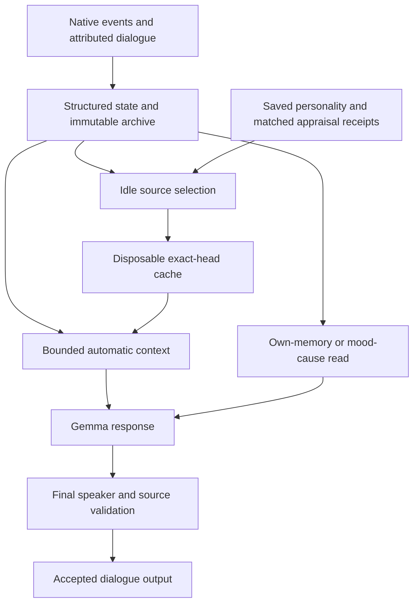

# NPC memory: authoritative records and bounded retrieval

Deployment update,23 October: [native acceptance](2026-10-23-memory-mood-native-acceptance.md) records installed bundle `86b3313d` and six final passing runs. This supersedes the source-only status of the original checkpoint below, without closing the broader storage/summary roadmap.

The agreed architecture keeps structured game state and immutable conversation records authoritative. Gemma can request a bounded additional read of the current speaker's memory or recorded mood influences. A disposable selection cache improves the default memory context. No vector database, embedding model or new service is introduced. Gemma E4B and Breeze remain the selected model stack; STT remains deferred.

## Data flow

The automatic context remains present even when the selector returns `NONE`. That command means no additional lookup. The selector can choose at most one additional read per turn, alongside existing topic and inventory reads. Memory reads accept only a short query; the runtime supplies identity, game time, archive branch and output budget. The model cannot read arbitrary NPC identities, write memories or select a save branch.

## Source authority and publication

`NpcMemoryReadSnapshot` is a process-local receipt, not a serialized model parameter. It binds the exact store and state instance, speaker, archive ID/head, capture time and source-specific authority. Memory reads track the speaker's append-only journal and the next future record becoming eligible. Mood reads bind the immutable experience inbox instance and mood revision. Consuming an inbox entry can replace that instance without increasing its enqueue revision, so the revision alone is insufficient.

The runtime buffers replies based on selected reads and checks the receipt at final stage publication. Same-head restore, changed source, replaced store, changed speaker or time rollback invalidate stale evidence. Fractional game time uses the same calculation as context capture. Session/request/save lifecycle transitions release old receipt references. See [read-tool integration and checks](2026-10-23-memory-read-tools.md).

## Emotion and personality

Mood context describes up to three recent recorded native influences whose projected effects remain nonzero. It identifies whether the affected subject was the speaker or another person, native event time, and the recorded responsible-actor category. Unknown responsibility stays unknown. These are recorded influences, not a complete causal decomposition of current mood or proof that the player caused it.

Memory selection receives an existing saved personality profile and accepted historical appraisal cues only when a source can be uniquely matched by observer, speaker, exact text, time and receipt provenance. Current mood is not substituted for past emotion. Positive mood impact is not proof of joy. Ambiguous, missing or unconsumed evidence cannot establish an emotional cue. A context fingerprint invalidates selections when relevant personality or appraisal evidence changes.

## Background selection and recall

The first implementation is extractive: Gemma chooses original source IDs; it does not write a new factual summary. Each completely scanned NPC/calendar-month group must be strictly older than 30 native game days. At most eight candidate rows and four selected sources fit the bounded request; oversized groups remain raw. Source text retains the existing attribution and uncertainty formatting.

The cache is keyed by policy, person, native month and exact archive head. It is optional, disposable and excluded from portable archive v1. Missing, corrupt, stale or unverified cache data falls back to raw recall. Query-matched raw evidence can still be returned even if the default selection omitted it. Raw archive bytes are never deleted. A new archive head currently requires new derived selections; descendant-head reuse is deferred. Dialog recall attempts at most eight sidecar reads, including failed reads. The per-person/head manifest has a 4096-group and 2-MiB bound.

The scheduler scans cooperatively and uses the existing low-priority dialogue slot. Foreground dialogue, speech, combat, pause and lifecycle changes preempt maintenance. Only its own request can be canceled. After twelve model attempts at the same checkpoint, maintenance pauses for 86,400 native game seconds, then resumes. The pause retains pending progress; idle interruptions do not replenish the budget. Nearby-speaker deferral currently covers the last tracked conversation actor, not a complete spatial query over every NPC. CPU tests validate contracts and cancellation; native frame-time behavior and Gemma's selection quality require a later coordinated game run.

## Remaining boundaries

A semantic index can later become another derived retrieval aid, with the same owner/branch filters and original-source validation. It must not replace structured state or turn a remembered assertion into a verified world fact. Free-form summaries, full emotional-event coverage, physical archive reclamation and complete companion/static-role integrations remain separate work.

The related native safety slice creates a persisted goal from directly witnessed hostile danger, fulfills it at actual refuge arrival and abandons it when the exact episode expires or the resident becomes ineligible. It is one lifecycle integration, not a complete autonomous goal system. See [safety implementation](2026-10-23-native-safety-goal-runtime.md).

No Unity bundle deployment or native gameplay acceptance is implied by these source changes.

## Verified source checkpoint

The parent agent ran the final integrated CPU checks after source review: Core1659/1659, adapter88/88, Safety7/7 and Commerce11/11 cases; compaction276, scheduler100, salience126, mood120, source receipt34, selector90, runtime gateway18 and existing knowledge-tool42 assertions. RuntimeCompile completed with zero warnings and zero errors. The mood suite contains11 cases. Test logs and commands are retained under `C:/Users/Daniel/Documents/Codex/2026-10-23/bit/work/architecture-final`.

Review corrections include defensive `ScanRecord.Entry` copies instead of synchronous full-archive scans, current-checkpoint and context validation, paged scan progress, cache read-attempt limits, renewable background budgets, explicit mood subjects, final read freshness and lifecycle release of receipts. These checks establish source and contract behavior; they do not establish model selection quality or native gameplay performance.
