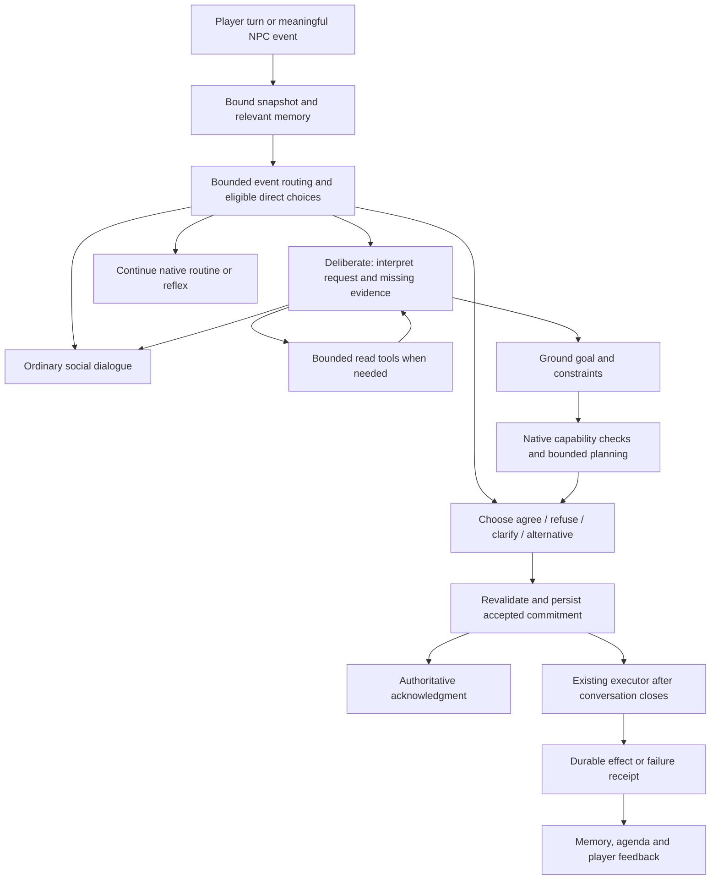

# NPC agent architecture and implementation handoff

**Project:** People of the Iliac Bay / LivingCities, Daggerfall Unity.  
**Date:** 20 October 2026.  
**Status:** Target architecture and staged delivery contract. This document does not certify implementation of the proposed components.  
**Owner model:** The supervising agent owns architecture, integration review, and acceptance. Delegate bounded implementation to explicitly selected `gpt-6-luna`, reasoning `high` or lower. The user intends to continue supervision with Sol.  
**Repository:** `C:/Users/Daniel/Desktop/Code_Experiments/DFU/LivingCities`.

## 1. Decision and boundaries

21 October user-approved framework supplement: [motivation, directed relationships and paid contracts](2026-10-21-npc-motivation-relationships-and-contracts.md) governs shared factors, decision-specific utility, information boundaries and daily-paid dungeon companions. Consult the [integration map and regression baseline](../../2026-10-21-framework-integration-map.md). This is an implementation target, not a finished feature or a silent change to binary D3 willingness.

Build a hybrid agent: language understanding and dialogue, an interchangeable decision scorer, a bounded native planner, and the existing authoritative executor. The initial Kev-4B experiment is preserved below as historical evidence. **Current runtime candidate is D3-mini Q4_K_M**, after the broader [D3 evaluation](2026-10-20-npc-model-capability-evaluation.md). D3-flash remains an offline reference: its measured standalone residency plus the current dialogue model exceeds the user's 12 GB budget before the game. Mini plus dialogue and a loaded disposable DFU city fixture reached 10,748/12,282 MiB with successful inference; other graphics configurations remain unverified. No scorer has live action authority. Do not replace population simulation with continuous model deliberation.

**Historical Kev adoption decision:** the Q4 decision head runs on this machine alongside Qwen, but the frozen choice trial does not justify live action authority. Kev matched 31/64 expected choices initially, then 4/4 on the exact requests rejected before inference after a configuration-only admission repair (combined coverage 35/68 across two batch configurations); Qwen matched 39/68. Both selected actions for non-requests. Keep Kev offline or in explicitly non-mutating shadow mode until a revised protocol passes new frozen tests. These are diagnostic option-selection results, not overall model rankings.

The user's proposed division is appropriate for choices already represented by the game: provide facts, personality, conversation, and options to Kev; validate its decision; execute through the harness; express the resulting state in dialogue. Complex requests also need an interpretation stage because Kev cannot produce arbitrary arguments or invent missing plans.

The key division is **meaning versus authority**. Models interpret language and suggest choices. Native code determines what exists, what is physically supported, whether constraints hold, and whether an effect actually happened. A valid JSON object or confident choice does not prove correct intent.

This is a general framework for errands, cooperation, conversation, obligations, and independent NPC activity. Do not specialize the architecture around a particular drink, shop, item, or test utterance. Lending/borrowing remains excluded. Speech input/output remains outside this work.

## 2. Verified starting point

The latest installed checkpoint before this design is package `F0406C29`, 1181/1181 Core tests, clean RuntimeCompile, with the native lifecycle and acknowledgment/provenance checks described in [TESTING](../../TESTING.md). These are historical acceptance results, not fresh tests of this design. The working tree contains extensive earlier work; do not reset it or commit unrelated changes.

| Existing component | Reuse | Do not assume |
|---|---|---|
| `ConversationContextSnapshot`, binding and formatter | Captured actor, clock, scene, request, save epoch, attributed history, known/unknown facts | Complete actor coverage or persistent conversation-driven mood |
| `ConversationContextTools` and runtime adapter | Bounded topic browsing and own-inventory reads | A complete live tool loop: topic reading, plan reads, and recall adapters still have unavailable paths |
| `NpcTaskPlan`, task/action stores, runtime adapters | Up to eight typed steps, exact targets, persisted progress, native effect receipts, once-only acquired-item handover | Arbitrary plans, task-level suspension, generic offscreen execution, or unrestricted multi-day tasks |
| Routine continuation and appointments | Remaining-day recovery, feasible optional-stop skipping, protected commitments and home return | A persistent general-purpose personal-goal system |
| Conversation journal and shared archive | Source-attributed exchanges, selected save ancestry, immutable archive heads | Self-contained save folders, semantic recall, or a complete belief model |
| Modern action acknowledgments | Native saved-state receipts | A final free-form LLM reply: this path currently appends deterministic acknowledgment text |

Previous whole-request planning diagnostics produced structurally valid but semantically wrong plans and false proposals. The matched 7B/9B comparison did not resolve native task approval. Preserve those failures; do not restart a large comparison simply to obtain a favorable sample.

## 3. Component responsibilities

| Component | Owns | Cannot authorize |
|---|---|---|
| Snapshot/context builder | Current facts, provenance, relevant history, personality, mood, relationship and commitments | Invented facts, future success, another actor's hidden inventory |
| Language interpreter | Goal, referents, quantities, temporal expressions, conditions, explicit exclusions, ambiguity | Native IDs, inventory mutations, route success, consent by itself |
| Decision scorer, initially Kev candidate | Selection among supplied interpretations or feasible responses; agree/refuse/clarify/alternative/social | Arbitrary argument generation, task construction, execution, proof of correctness |
| Capability registry and binder | Actor-supported operations, verified references, native preconditions, known costs | Willingness inferred from capability or missing facts treated as zero |
| Bounded planner | Dependency order and concrete steps that satisfy a grounded goal | Additional purchases, omitted obligations, silently changed quantities or durations |
| Commitment coordinator | Accepted goal, ownership, progress, cancellation, later planning and routine recovery | Success without receipts or overlapping owners for one NPC |
| Existing executor | Physical actions, native transactions, revalidation, durable outcomes | Language interpretation or conversational promises |
| Dialogue renderer | Natural social text and wording consistent with approved dialogue acts | Altering the decision, beginning an action, turning intention into completion |
| Agenda scheduler | Cheap routine choices, protected duties, event-triggered reevaluation and bounded personal goals | Model calls for every NPC every frame |

Kev uses a transformer backbone and a non-generative decision head; it is not a symbolic planner. Its probability describes relative choice scores under the supplied question, not a guarantee that the chosen action is good. Independently answered questions may conflict. Prefer a coherent complete choice; validate consistency before combining outputs. [Kev model card](https://huggingface.co/jaredpalmer/kev-4b)

## 4. Turn processing



**Simple choice:** if native code already has an unambiguous bounded set of complete interpretations, Kev can select directly. A social route can proceed to the dialogue model. Do not force every social sentence through task decomposition.

**Complex request:** use the language model to extract a structured goal and constraints from the exact utterance plus attributed history. Resolve references through bounded tools. The native planner produces feasible plans, then a decision scorer assesses willingness and alternatives against the original request and NPC state. Never replace the original text with the extractor's summary alone.

**Existing commitment:** cancellation, modification, and assent bind to the specific live commitment or pending offer. Closing and reopening chat is not a new meeting. Scene transitions do not imply separation while an outing remains active.

**Commit:** validate request/actor/scene/save binding, candidate-set revision, resources, capability and schedule; persist one accepted commitment before acknowledgment. The executor starts physical work after the conversation closes, as today. On stale input, recapture or explain that circumstances changed; never apply the old result to a new speaker or restored save.

**Failure:** distinguish unsupported request, missing evidence, ambiguous intent, NPC refusal, transport error, stale request, native rejection, and execution failure. They need different outcomes. A server outage must not masquerade as the NPC repeatedly saying a stock refusal.

### 4.1 Fast reactions and selective deliberation

The Halo video's author describes event-first routing: Kev makes quick choices and decides whether Gemma needs further deliberation. He identifies Gemma 4 12B as the thinking model, Parakeet as speech recognition and Breeze TTS 2 as speech output. He also feeds in-game voice lines into the companion's observations. This is the author's high-level explanation, not a verified reconstruction of his unavailable implementation. [Model roles, 2:50–3:17](https://www.youtube.com/watch?v=EOfm3h4xYU8&t=170s), [event routing, 7:02–7:35](https://www.youtube.com/watch?v=EOfm3h4xYU8&t=422s), [voice-line observations, 8:00](https://www.youtube.com/watch?v=EOfm3h4xYU8&t=480s).

Apply that separation to DFU without importing shooter micromanagement. Existing navigation, obstacle avoidance, immediate danger handling and routine advancement run natively. Coalesce relevant game events into bounded observations with actor, source, game time, visibility and revision; drop irrelevant background events before any model call. Event filtering uses native relevance and perception, not keyword interpretation of player speech. A validated decision service can later choose among already grounded actions, continuation, clarification, social response, or escalation to goal interpretation. Do not require a serial Kev-plus-LLM call for every movement or every sentence. Ordinary social text still needs the dialogue model; complex requests need deliberation even when Kev is fast.

All paths share one commitment/effect owner. Record the revision against which deliberation began. A newer cancellation, scene transition or task change invalidates an older model result; it must not restart a canceled task. A fast reaction and a later answer cannot each commit the same action. Resource transfers and purchases always pass normal native permission, funds, ownership and once-only effect checks. Fast routing is a latency policy, not an exception to validation or consent. Initially preserve the current rule that accepted conversational tasks start after chat closes; existing native reflexes remain independent.

This is a proposed DFU adaptation. The transcript does not specify the exact option catalog, prompts, confidence thresholds, model quantizations, event API, planner or persistent-memory design. It therefore cannot certify our multi-step errands, save isolation, friendship growth or deployment performance. The current Kev trial also shows why the event router needs its own role-aware request/quotation/history tests before it receives authority.

## 5. Context and tools

Always retain a compact core: identity and actual role, explicit current game time/day period, NPC location and physical activity, stable personality, current mood, relationship/familiarity, active commitment/shared activity, exact player turn, and the recent relevant exchange. Weather affects mood only when the NPC's own observed scene is outdoors.

Retrieve larger data when required: native topics, own inventory, observed containers, schedule/commitment details, relevant memories, local destinations, and capability candidates. Supply a small tool catalog, not every item/topic/target. Tool pagination must state that further results exist; a first page is not the whole world.

Reuse the current tool request/result types and their owner/revision/page checks. Add typed results for location, role, plans, knowledge, and capabilities instead of unbounded free-form descriptions. Location tools expose the actual observed exterior point or interior building/room; the language model resolves “here” using that evidence. No word-specific veto.

Initial operational limits are configurable design defaults: two read rounds, at most three reads per round, at most 20 rows per page, and at most 12 materialized plan alternatives per decision. If the cap is reached, narrow the request or clarify; never silently truncate an explicit requirement. Keep one selected NPC's dialogue request ahead of background deliberation. Tune limits from recorded behavior, not convenience.

Token budgeting must use the active tokenizer. The currently configured dialogue context is 4096 tokens. Preserve the exact current turn, core identity/time/commitment facts and complete relevant exchanges first; shorten retrieved pages before dropping those. If required content cannot fit, return a bounded clarification or technical unavailable result. A fixed character count is not a token guarantee.

## 6. Proposed contracts

The names below are **proposed new contracts**, not claims that these types exist. Reuse existing `ConversationContextBinding`, tool types, `NpcActionTarget`, `NpcTaskPlan`, and store revision checks rather than creating parallel authorities.

| Contract | Required data and invariant |
|---|---|
| `NpcGoalProposal` | Request binding; exact source utterance; attributed source spans; goal kind; unresolved references or resolved opaque handles; quantities; budget/payer; time constraints; ordering; conditions; exclusions; missing fields. Source spans must be valid offsets, but this alone does not prove semantic correctness. |
| `NpcBoundGoal` | Validated proposal; bound target handles and their revisions/provenance; consent scope; explicit unknowns; normalized units. Models never supply Unity coordinates or fabricate item UIDs. |
| `NpcPlanOption` | Opaque option ID; immutable set revision; full goal coverage; steps/dependencies; estimated duration/cost; required resources; assumptions; unsupported portions; native feasibility status. Only fully executable options may be offered as immediate acceptance. |
| `NpcDecisionRequest` | Binding; original turn; relevant facts; complete offered options including social/no-action, clarification and refusal; question purpose; frozen model/config version. |
| `NpcDecisionResult` | Selected offered ID; probability vector where supported; source/model/version; request hash; latency; status `Ok`, `Unavailable`, `Invalid`, or `Stale`. No game mutation and no generated target fields. |
| `NpcCommitment` | Stable ID/revision, owner, accepted goal and consent scope, participants, status, active task ID, progress and effect IDs, deadline/conditions, saved routine continuation. No second active owner for the same NPC. |
| `NpcDialogueAct` | `Social`, `Clarify`, `Refuse`, `ProposeAlternative`, `Accepted`, `Progress`, `Completed`, or `Failed`; facts and receipt IDs that support it; optional reason. Accepted and completed are different acts. |
| `NpcKnowledgeRecord` | Subject, predicate/value, source/witness, observed time, confidence/uncertainty, ownership/access and save ancestry. A player claim and a native observation are different record kinds. |

Define an interchangeable decision interface at the service boundary. A Kev adapter calls `/v1/systemone`; a language-model adapter uses constrained choice output. Both return the same validated result contract. Do not leak Kev-specific probabilities into the executor or save schema. Persist decisions and commitments, not live model connections or GPU caches.

No threshold has been validated for this NPC domain. Select abstention thresholds on a development set, freeze them, then evaluate a separate set. Do not hardcode a convenient confidence such as 0.8 and call it safe. A model that always refuses can have few false actions while being useless; measure correct-action coverage too.

## 7. Goal planning and execution

Use a small C# hierarchical task planner: reusable goal methods expand into the existing action vocabulary; each method has explicit preconditions, dependencies, effects, duration estimates and resource limits. Rank feasible methods using existing duties and simple utility scores. This is bounded procedural planning, not a global search over every object in Daggerfall.

Example goal: obtain an identified item for the player within an agreed budget, then deliver it. Depending on capabilities, the method may resolve a shop, navigate there, inspect current stock, obtain a valid quote, purchase, locate the agreed recipient, transfer the exact acquired item, and resume the day's routine. Each stage is conditional on real capability and evidence. The current loaded-shop purchase path does **not** establish that this whole cross-building method already works.

The language interpreter identifies requested goal, constraints and references; it does not write executable paths. Native code performs arithmetic after typed extraction: time-of-day conversion, quantity totals, affordability and unit normalization. Keep requested game-time duration, task deadline, and real-time service timeout separate. Do not infer meaning from raw-text regexes.

An NPC may agree to **try** an errand when future stock is unknown, but that is a distinct attempt commitment with an agreed budget and failure outcome. It is not a guarantee of acquisition. If the system cannot represent that distinction, clarify before acceptance. Never reserve or debit items merely because a model predicted success.

Preserve the existing eight-step task bound initially. Reject or clarify a goal that cannot be represented within supported methods. Later, a durable commitment coordinator may issue successive bounded task segments, retaining goal ownership and completed effects between segments. This must prevent routine recovery between unfinished segments and survive load/cancellation. Do not merely raise the limit or discard excess steps.

Purchase and transfer operations require native validation at execution time: ownership, access, price, funds, stock, quantity, recipient and exact acquired item. Use existing effect IDs and stores for idempotency. A future `Replan` path starts from committed effects; it must not buy or deliver again after a retry. Do not claim atomic transactions across unrelated native operations without demonstrating crash/save recovery.

Interruption handling has explicit policies: cancel, wait for a permitted event, replan, or fail. Task-level suspension is new work, not an existing feature. Dangerous scenes and quest control retain precedence. On terminal commitment, run the actual remaining-day recovery: skip only infeasible optional visits, protect fixed appointments and home/sleep, and physically rejoin a valid route where required.

## 8. Truthful dialogue and social behavior

Keep the currently tested deterministic acknowledgments for accepted/failed/completed actions during migration. Ordinary conversation remains dynamic. Later natural wording for action outcomes must consume `NpcDialogueAct` and authoritative receipts; it cannot change their status. Show an English HUD/event receipt for material effects so the player knows what happened.

A prose validator may detect contradictions but cannot guarantee that free-form text is truthful. Treat its score as supporting evidence, not transactional authority. Never recover an invented purchase from prose by executing it afterward. If wording fails validation, use the authoritative receipt; do not replace every social answer with a generic refusal.

Relationships require separate concepts: familiarity, trust/affection, fear/resentment, obligation, and short-term mood. Conversation can propose bounded, evidence-linked changes; native code enforces limits, once-per-event accounting and persistence. Failed server responses do not count as successful shared experiences. Repeated chat reopen must not farm friendship.

Implement the accepted gradual friendship rule: at most +5 per conversation, replenishing positive-gain allowance continuously over 24 hours, then 30, 36, and subsequent +6-hour intervals as growth advances. Waiting replenishes allowance but never grants friendship. Persist fractional allowance, timestamps and progression; specify and test the progression boundary before implementation. Avoid inventing a different instant-unlock rule.

Persist conversation-driven mood with decay toward a personal baseline. Weather is an outdoor modifier, not a universal explanation. Use actual shared-activity state for continuation greetings. Preserve the agreed meeting waiting range of 10 in-game minutes to 2.5 hours based on disposition, later no-show follow-up, and randomized 6–12-hour pause after a busy dismissal. These are requirements; verify which portions already exist before modifying them.

## 9. Memory, knowledge and saves

Keep three layers: authoritative current world facts; attributed episodic experiences/observations; derived summaries or beliefs. Summaries and model inferences never overwrite facts. Retrieval first filters by actor, access, save ancestry and time, then ranks relevant evidence. Embeddings may improve paraphrase recall later; they are optional, rebuildable indexes rather than a new source of truth.

Own inventory can be read live. A foreign container is only known as last observed, with timestamp, unless current perception/access permits a refresh. Knowing an item exists does not imply permission to take it. Dialogue should distinguish ignorance, uncertain memory, player claims and observed facts.

Reuse the immutable `PeopleMemory` archive and save checkpoint. Add a player-facing portable-save export/import workflow that includes referenced ancestry and pending records, validates hashes, and reports missing dependencies. Package publication must be recoverable after interruption. No global “latest memory” lookup may leak facts from a sibling save branch. Keep recovery evidence; do not silently substitute another branch.

## 10. Autonomous life and simulation

Use existing schedules for ordinary daily activity. Add a bounded personal-goal ledger and utility selection over feasible activities: duties, needs, preferences, resource state, relationship obligations and still-relevant deferred errands. Protect home/sleep and fixed commitments. Add hysteresis and minimum commitment periods to avoid constant switching. Optional pub visits may expire; they must not become mandatory through unbounded urgency aging.

Run model decisions at meaningful events: an unusual player request, a conflict requiring negotiation, an important changed circumstance, or an eligible social initiative. Common travel, pathfinding, obstacle avoidance, seating and routine transitions remain native algorithms. One shared model service handles relevant NPCs; do not create a process per actor.

Preserve analytic offscreen schedule reconstruction. Waiting indoors must place actors according to elapsed schedules, including those already seated or already departed; it must not queue every missed entrance. New offscreen task effects require an explicit authoritative simulation adapter. Never fabricate shop stock or purchases merely because enough time passed. Until such adapters exist, keep those tasks pending or fail truthfully according to their contract.

Future outdoor inn/terrace seating uses actual seat ownership and reachable elevated geometry, only in good weather, with higher outdoor demand then. Markets become visit destinations with bounded stall/stage browsing. Stationary performers and staff need verified roles and capabilities; their conversion to mobile schedules remains undecided. Preserve native quests, services and authored identities.

NPC-to-NPC interaction can produce bounded event records, opinions and attributed rumors without generating full background dialogue. Propagation needs provenance, limits and uncertainty. A facing pose alone is not evidence that an exchange occurred.

## 11. Hardware and model choice

Verified hardware: RTX 4070 SUPER, 12282 MiB VRAM; Ryzen 9 9950X, 16 cores/32 threads; approximately 64 GB installed RAM. Current baseline is Qwen2.5-7B-Instruct Q4_K_M, context 4096, one server slot. Retain it until an alternative passes the relevant evaluation.

**Later user-authorized configuration change, 20 October:** the active dialogue server now uses Qwen2.5-7B-Instruct-abliterated-v2 Q4_K_M. The original remains the comparison and rollback baseline. This requested swap passes startup/compatibility checks and the same 21/22 intent fixture score with a different failure; it is not a general quality verdict or acceptance of Kev. Respect `local-llm/active-model.json` rather than restoring the old model merely from this document's historical baseline references. See the [swap report](../../../work/abliterated-swap-20261020/report.md).

The earlier CPU-only Kev recommendation was too restrictive: llama.cpp now supports the decision head and `/v1/systemone`, and ggml-org supplies a Q4_K_M GGUF of 3,033,489,824 bytes and Q8_0 of 4,483,801,504 bytes. Use the compatible decision API, not ordinary text completion. The initial Q4 smoke test loads alongside Qwen; full empirical results belong in the trial report linked below. [GGUF release](https://huggingface.co/ggml-org/Kev-4B-GGUF), [llama.cpp integration](https://github.com/ggml-org/llama.cpp/pull/29818)

Keep CPU serving or partial GPU offload as fallback options if the game plus both models exceeds a safe measured memory budget. File size is not peak VRAM. Do not infer gameplay headroom from an idle desktop test. Measure cold/warm latency, GPU memory, RAM, and frame-time impact with DFU running before enabling simultaneous production use.

The completed Q4 trial sampled 9414–9557 MiB of total GPU use with both servers loaded and no game running. The batch-512 admission repair began near 9908 MiB. Initial Kev request latency was p50 85 ms / p95 101 ms; Qwen constrained-choice latency was 156/211 ms. These short-choice requests do not measure dialogue generation, a full turn, or gameplay frame time. The four repaired Kev requests have separate timings. Exact requests, parameters and failure counts are in the [trial report](../../../work/kev-trial-20261019/report.md). The owned Kev process was stopped afterward; the baseline Qwen service was retained.

Gemma 4 12B instruction-tuned is a possible later dialogue/interpreter candidate, not a required second decision system. The Halo author names Gemma 4 12B but does not establish the exact checkpoint or quantization. His high-level routing is now documented in section 4.1; source-level wiring remains unavailable in the inspected OpenCE main branch. Speech models remain excluded. No additional model download is required by this architecture. [Gemma model](https://huggingface.co/google/gemma-4-12B-it), [Parakeet model](https://huggingface.co/nvidia/parakeet-tdt-0.6b-v2)

## 12. Delivery sequence and review gates

20 October checkpoint: [native route eligibility and actual-model replay](2026-10-20-native-route-replay-evaluation.md) now provide B/C source/native evidence and 640 frozen classification calls. V2 menus use captured native state to remove unavailable offer/commitment choices. This guarantees menu eligibility, not faithful interpretation: held-out scores fell after masking. Keep the router untrusted and require the complete interpreter/consent/Core/receipt boundary before Slice D can grant action authority. The native capture/probe remains explicitly opt-in; this does not permanently disable the planned decision adapter.

Each row is a separate reviewable slice. Do not assign overlapping runtime ownership to multiple workers. The supervisor reviews code, runs aggregate checks, and owns installation/native testing.

| Slice | Deliverable and likely files | Required evidence before advancing |
|---|---|---|
| A. Offline choice trial — completed, live adoption rejected | `work/kev-trial-20261019/`; no production edits | Frozen 34 cases, both option orders; Kev initially 31/64 plus 4/4 after admission repair, Qwen 39/68 expected; preserve false-action selections. A revised protocol requires a new frozen development/held-out evaluation, not rerolls of these results |
| B. Decision service boundary | New Core `NpcDecisionContracts.cs` and tests; new runtime `LocalDecisionClient.cs`; existing snapshot binding | Invalid IDs/probabilities, missing options, timeout, cancellation, stale actor/save/scene and duplicate callback tests; no effects from the adapter; feature off by default |
| C. Shadow routing | New runtime `LivingCitiesMod.Decisions.cs`, wired beside existing `ConversationKnowledge`/`DialogueSemanticTasks` paths | Observe real snapshots and compare decisions without dispatch; technical failure remains separate from refusal; real player text never triggers action in shadow mode; event coalescing, escalation, cancellation and stale slow-result tests |
| D. One bounded action path | Existing action-chat entry points and `LivingCitiesMod.ActionReplies.cs`; B/C contracts | Actual polite/negated/historical/quoted/conditional/assent/cancel controls; preserved argument fidelity; exactly one accepted job and native effect; truthful receipt and save/load behavior |
| E. Grounded goal interpretation | New Core `NpcGoalContracts.cs`, `NpcGoalBinding.cs` and corresponding tests; existing read tools | Exact source spans and original turn retained; ambiguous references, missing target, unknown stock, quantities, budget/payer, duration units and unsupported conditions tested; no native mutation |
| F. Reusable bounded planner | New Core `NpcGoalPlanner.cs`, `NpcGoalMethods.cs` and planner tests; adapt to existing task store | Goal coverage, prerequisites, legal ordering, missing capability, eight-step limit, protected schedule and no hidden extras; at least three distinct goal families rather than one example |
| G. Durable commitment coordinator | New Core commitment/store files; `WorldState.cs`, runtime task dispatch and routine recovery | Save-version migration, ownership, cancellation, duplicate result, partial completion, replan, scene changes, failure feedback and routine rejoin; segment continuation only after basic coordination passes |
| H. Knowledge and memory | Existing tools, journal/archive, new evidence-linked knowledge/episode types | Live/observed distinction, paraphrase recall, access/branch filtering, no fabricated facts, portable-save transfer and interruption recovery |
| I. Mood and relationships | `ConversationAttitudes.cs`, `ConversationLifeContext.cs`, world-state persistence | Conversation effects, indoor weather exclusion, gradual allowance, fractions and reload/reopen resistance, shared-activity and proactive-contact tests |
| J. Personal agenda and world expansion | Existing itinerary/recovery, bounded goal ledger, actor capabilities | Multi-day goal progression, optional-stop expiry, protected sleep, time skips, market/outdoor seating, truthful stationary roles and settlement-scale cost |

Slices H/I can be separately specified and delegated after contracts are stable. Avoid a giant branch combining planner, memory, social progression and seating. Map delivery to IMM-01/02/03/04/18 first; H covers IMM-04/05/06/20, I covers IMM-07–11/14, J covers IMM-12–17. IMM-19 is the combined lifecycle gate, not a substitute for component checks.

## 13. Acceptance and evidence rules

1. Freeze test inputs and allowed outputs before inference. Keep failures, request hashes, model revision, quantization, prompt version, and option order. Separate diagnostic fixtures from new stress cases; neither is a representative benchmark without a defined sampling method.
2. Score interpretation, argument fidelity, plan feasibility, NPC willingness consistency, receipt truth and native effect separately. A plausible refusal is not automatically a failure; a syntactically valid plan is not automatically correct.
3. Include same-person multi-turn context, interruption, cancellation, changed subject, tentative offer, polite indirect request, negation, quotation, history, hypothetical, unsupported target, missing inventory, stale quote, conflicting commitment and save rollback.
4. Measure false action selections and correct-action coverage. Any fabricated native effect, double transfer, cross-save result or ignored cancellation blocks deployment. Zero observed errors in a small set is not proof of safety.
5. Use original and reversed option order to expose sensitivity; do not hide it by rerolling. Confidence calibration and quantization parity are separate evaluations. A Q4 failure alone does not prove that quantization caused it.
6. Runtime acceptance requires observable movement/transactions and persisted state, not a helper's return value. Test owned sessions only; do not kill the user's game or replace its loaded mod.
7. Final combined acceptance: meet a stranger, develop familiarity over days, agree to a task, interrupt the routine, complete or fail it, recover the day, separate, reload a save, recall the event, and initiate an appropriate later conversation. Include an alternate save branch and elapsed indoor waiting.

### 13.1 Promotion rule for the next decision protocol

Freeze the model, quantization, prompt, option construction, abstention policy and scoring before evaluating a new held-out set. Use the retained 34 diagnostic cases for development and regression; do not relabel them as held-out data. Confidence thresholds must be chosen on development data and frozen before the held-out run.

User clarification on 20 October supersedes the original fixed 90%/95% and zero semantic-error thresholds: model decisions need not be perfect. Aim for broad held-out coverage, including no-effect/unsafe-to-act controls and supported positive requests across multiple actors and scenes. Evaluate original and reversed option order once. Report raw and severity-weighted accuracy, positive-request coverage, false-action proposals, abstention, order sensitivity, technical failures and latency by capability; higher useful accuracy is better. Accept legitimate refusal/clarification alternatives where the supplied facts permit them. Abstention does not count as successful positive coverage, and willingness is scored separately from understanding. Preserve transport failures and their denominator. Development cases remain development evidence; do not relabel them as held-out tests.

Use the scorecard to choose bounded rollouts and recovery behavior, not to demand universal model perfection. A failed held-out case becomes a retained regression; changed protocols need fresh held-out evidence. Deterministic native integrity remains mandatory: effects without current consent, duplicate transactions, ignored cancellations and cross-save results block deployment. Model mistakes must remain proposals rejected or clarified by the harness. Slice D still requires native lifecycle, stale-result, cancellation, receipt and once-only effect tests. Wider action families need their own acceptance. Measure actual game responsiveness and memory headroom before simultaneous production serving. Passing finite offline tests cannot prove that every later failure must belong to Unity integration.

Existing commands for source work, from repository root:

```powershell
dotnet run --project tests/LivingCities.Tests --no-restore
dotnet build tools/RuntimeCompile/RuntimeCompile.csproj --no-restore
git diff --check
```

Use the relevant documented `tools/TownTest.ps1` probes after reading their parameters and fixture requirements. Do not infer a whole feature passed from a partial marker. Record package/source hashes and restore the test fixture baseline. No new production build is required for this design document or offline trial.

## 14. Sol handoff: next actions and stop conditions

1. Read this document, the top of [ROADMAP](../../ROADMAP.md), [TESTING](../../TESTING.md), and the [Kev trial report](../../../work/kev-trial-20261019/report.md). Confirm current source/build/model state; earlier checkpoints are historical.
2. Inspect the trial's raw failures and option-order behavior. Decide whether Kev merits shadow use, needs a focused protocol correction, or should remain offline. Do not adopt it merely because it fits VRAM.
3. Write a narrow executable plan for slice B with exact interfaces and failure tests, then delegate bounded implementation to Luna. Review each worker's diff and run shared checks yourself. Do not widen into goal planning before B–D pass their gates.
   Slice B is useful infrastructure even if Kev remains rejected. Do not enable slice D while the false-action blocker from A persists. Next model experiment, if authorized, should isolate request-versus-report routing and option/question design before testing full errands; it must retain independent held-out cases and the original failures.
4. Preserve the current installed runtime and the user's active dialogue-model selection while implementing the selected slice. Retain original model files for comparison and rollback. Test flags default off. Never switch models while the user is playing.
5. When a slice fails, retain evidence and fix the demonstrated cause. Do not add phrase-specific semantic rules, suppress hard cases, remove failing assertions, or endlessly rerun the same model request for a favorable answer.

**Known limits:** no claim of arbitrary natural-language task planning; no guarantee against all conversational hallucinations; no complete generic offscreen transaction simulation; no proof of full-game performance from offline GPU measurements. These remain engineering and evaluation boundaries, not reasons to abandon the hybrid design.

**Operational preference (20 October overnight instruction, latest shutdown follow-up):** the user requests shutdown after the bounded current work. Complete the current test, preserve source/evidence, pause the unfinished goal and shut down without starting another package or forcing unsaved applications closed. The latest quota reading is 43 percent remaining; the earlier 40-percent threshold is not reached and is not the reason for this pause. Resume only on user instruction. Keep game text English. Keep architecture decisions and test outcomes in repository documents and Obsidian, not only in conversation history.
